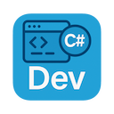

# Dev

[](https://www.nuget.org/packages/HC.Dev/)

A .NET tool designed to simplify common development tasks for .NET projects.

## Installation

You can install the tool globally using the .NET CLI:

```bash
dotnet tool install --global HC.Dev
```

To update to the latest version:

```bash
dotnet tool update --global HC.Dev
```

### Signed standalone executable (Windows)

Every release also attaches signed, single-file executables to its [GitHub release](https://github.com/hansen-consultancy/Dev/releases): `dev-win-x64.exe` and `dev-win-arm64.exe`. They need the .NET 8 runtime, like the tool. Use one when Smart App Control or WDAC blocks unsigned programs. The global tool's `Dev.dll` is signed, but the `dev.exe` launcher that `dotnet tool install` creates is generated on your machine and stays unsigned. Save the exe as `dev.exe` in a folder on your `PATH`, and uninstall the global tool (`dotnet tool uninstall -g HC.Dev`) so the two don't clash. Update by downloading the newer exe.

## Features

### Launch Solution or Project

The default command launches the current solution in your default IDE or project in Visual Studio Code.

```bash
dev
# or
dev launch
```

### Bump Version

Bumps the version of all projects in the current solution or the current project.

```bash
dev bump [major|minor|patch|revision]
```

The bump command supports the following options:
- `major`: Increments the major version (e.g., 1.0.0 → 2.0.0)
- `minor`: Increments the minor version (e.g., 1.0.0 → 1.1.0) - Default
- `patch`: Increments the patch version (e.g., 1.0.0 → 1.0.1)
- `revision`: Increments the revision version (e.g., 1.0.0.0 → 1.0.0.1)

### Bump and Commit Version

Bumps the version of all projects in the current solution or the current project and creates a git commit and tag for the new version.

```bash
dev bump-commit [major|minor|patch|revision]
```

The `bump-commit` command supports the following options:
- `major`: Increments the major version (e.g., 1.0.0 → 2.0.0)
- `minor`: Increments the minor version (e.g., 1.0.0 → 1.1.0) - Default
- `patch`: Increments the patch version (e.g., 1.0.0 → 1.0.1)
- `revision`: Increments the revision version (e.g., 1.0.0.0 → 1.0.0.1)

This command will:
1. Update the version in the `.csproj` or all projects in the `.sln`.
2. Stage the changes using `git add`.
3. Create a commit with the message `build: {version}`.
4. Tag the commit with the new version.

### Build Solution or Project

Builds the current solution or project in Release mode.

```bash
dev build
```

If a `build.cmd` (Windows) or `build.sh` (Linux/macOS) file exists in the same directory, it will be used instead.

### Frontend Building

Runs the Vidyano frontend builder in the current directory using Docker.

```bash
dev frontend
```

This command uses the [`ghcr.io/stevehansen/vidyano-frontend-builder`](https://github.com/stevehansen/vidyano-frontend-builder) Docker image to build your frontend. The image is pinned by digest (not floated on `:latest`) so the exact builder is verified on every run; a new builder ships with a new release of this tool.

### Synchronize Vidyano App

Runs the Vidyano service's own synchronize CLI against the Vidyano app in the current solution, updating its model and schema files after backend changes (new entities, changed properties) or after a Vidyano package upgrade.

```bash
dev synchronize
# or
dev sync
# or, when the solution holds more than one Vidyano app
dev sync MyProject
```

Under the hood this runs:

```bash
dotnet run --project <app> -- --vidyano-update-model=yes --vidyano-synchronize-schema=yes
```

The app project is the one with an `App_Data/model.json` (or `wwwroot/App_Data/model.json`) beside it; other projects in the solution are ignored. If the solution holds several, `dev sync` lists them and asks you to name one. Both switches are no-database operations and the service exits when they finish — `--vidyano-update-model` only does work when the Vidyano dependency changed, so it is always passed.

### Clean working directory

Removes build output from the current directory.

```bash
dev clean
```

### Base64

Base64-encodes or decodes without a separate app. One input rule for both directions: an argument that names an existing file is read as bytes, any other argument is the value itself, and with no argument the input is read from stdin.

```bash
dev b64 cert.pfx                       # file -> base64 on stdout
dev b64 "some text"                    # text -> base64
Get-Content notes.txt | dev b64        # stdin -> base64
dev b64 -d aGVsbG8=                    # base64 -> text on stdout
dev b64 -d cert.b64 -o cert.pfx        # base64 (text or file) -> bytes in a file
dev b64 cert.pfx -c                    # copy to the clipboard instead of printing
```

- `-d`/`--decode` decodes; line breaks and surrounding whitespace in the input are ignored. Invalid base64 fails with exit code 1.
- `-o <file>`/`--output <file>` writes the result to a file. Binary decoded data is refused on a terminal: use `-o` (or redirect stdout).
- `-c`/`--clip` (Windows) copies the result to the clipboard, excluded from clipboard history (Win+V) and cloud clipboard, and clears it after 30 seconds unless you copied something else since. A warning is printed when the input looks like a certificate or private key (`.pfx`, `.p12`, `.key`, a PKCS#12 header or a PEM private key).
- Piped text loses one trailing newline (PowerShell and `echo` add one); pass a file for byte-exact input. Use `--` before text that starts with `-`.
- Prefer a file over a literal argument for secrets: arguments end up in shell history.

`b64` works in any directory: it needs no solution or project and is not affected by `commands.json`.

### Help

Displays help information.

```bash
dev help
```

### Custom Commands

If a `commands.json` file exists in the current directory, it defines the available commands. Each entry can either reference a built-in command or specify processes to run on Windows and non-Windows systems. A command can be marked as the default using `"Default": true`.

The keys are case-sensitive and use PascalCase: `Name`, `Description`, `Default`, `BuiltIn`, `Windows`, `NonWindows`.

```json
[
  {
    "Name": "build",
    "BuiltIn": "build"
  },
  {
    "Name": "deploy",
    "Description": "Publish the solution",
    "Windows": "dotnet publish {sln} -c Release",
    "NonWindows": "dotnet publish {sln} -c Release",
    "Default": true
  }
]
```

Placeholders `{sln}`, `{project}` and `{dir}` in the command lines are replaced with the detected solution file, project file and current directory. For safety, a command is refused (it does not run) when one of these placeholders resolves to a path containing a shell metacharacter (`& | ; < > \` $ " ' %`, or a line break), so a maliciously named file or directory cannot inject commands.

When no default is specified and you run `dev` without arguments, the tool lists all commands found in `commands.json`.

## Command Aliases

The following aliases are available for commonly used commands:

| Alias | Command |
|-|-|
| b | build |
| c | clean |
| h | help |
| f | frontend |
| s, sync | synchronize |
| v | bump |
| vc | bump-commit |

## Combining Commands

You can combine multiple commands using the `+` operator to execute them sequentially:

```bash
# Build then run frontend
dev b+f

# Clean, build, then run frontend
dev c+b+f

# Using full command names
dev clean+build+frontend
```

When combining commands, execution stops if any command fails.

## Releasing

`dev bump-commit` and pushing the version tag start `.github/workflows/publish.yml`. It tests, builds, signs `Dev.dll` and the standalone executables with **Azure Artifact Signing**, checks that each shipped file has a valid timestamped signature, creates the GitHub release, then pushes to NuGet. Nothing is published unsigned.

One-time setup (the workflow's first step names any variable that is missing):

1. **Artifact Signing account and certificate profile** (Public Trust). The existing account and profile used by the other repositories can be reused.
2. **Federated credential** on the app registration that has the *Artifact Signing Certificate Profile Signer* role on that profile: scenario *GitHub Actions deploying Azure resources*, organization `hansen-consultancy`, repository `Dev`, entity type **Environment**, name `release`. This repository uses GitHub's default subject format, so the subject is `repo:hansen-consultancy/Dev:environment:release` (check with `gh api repos/hansen-consultancy/Dev/actions/oidc/customization/sub`).
3. **GitHub environment** `release`, with deployment tags restricted to version tags (`*.*.*`).
4. **Variables** on the repository or the environment: `AZURE_CLIENT_ID`, `AZURE_TENANT_ID`, `AZURE_SUBSCRIPTION_ID`, `AZURE_SIGNING_ENDPOINT`, `AZURE_SIGNING_ACCOUNT`, `AZURE_SIGNING_PROFILE`. They are variables, not secrets: none grants anything on its own.

Artifact Signing certificates are valid for three days. A signature keeps verifying after that only because it is timestamped, which the workflow checks.

## License

This project is licensed under the MIT License. See the LICENSE file for details.